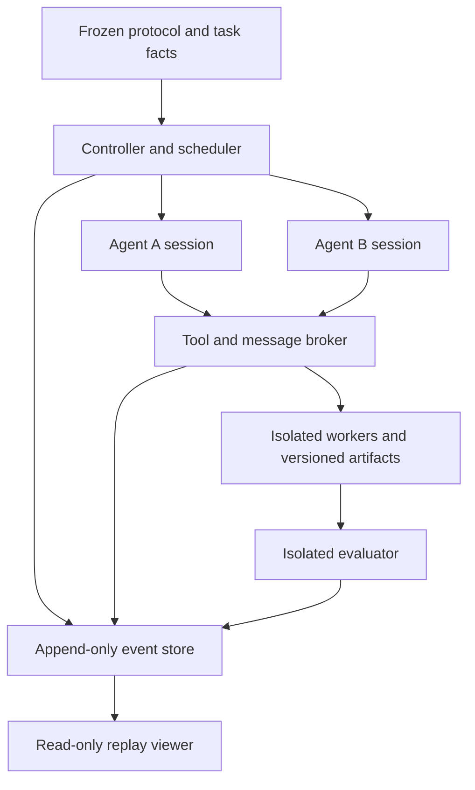

# Agent Coordination Laboratory — initial design for Mission Control

**Design:** ACL-DESIGN-001 v0.1  
**Date:** October 17, 2026  
**State:** PROPOSED / AWAITING INITIAL DESIGN REVIEW. This is not an execution freeze.  
**Scientific status:** HYPOTHESIS for representation effects; OPEN for comparative results and external usefulness.  
**Authority boundary:** Design documents only. No laboratory code, agent session, simulation, pilot, acceptance test, or replay viewer has been implemented or run for this assignment.

## 1. Recommendation and review decision

Build a replay-first laboratory around one bounded task family: two agents implement the producer and consumer of a small data pipeline. Each owns a necessary module. Independently valid implementations can disagree about the exact wire contract or its current version. Successful completion requires working code, a compatible contract, and contributions accepted from both permitted owners.

The first comparison should ask:

> When the same task facts are available, does making their compatibility relationships explicit change the probability or cost of producing correct integrated software under a fixed interaction budget?

Compare individual briefs with accessible ordinary source records, explicit relational views, and compact reconstructible views. This first comparison tests **presentation, retrieval, and reconstruction under a budget**, not irreversible information loss. It must permit a competent individual-brief baseline to inspect facts, communicate, and succeed.

Proposed bound: six evaluation fixtures × three representation conditions × two fresh repetitions = **36 two-agent runs**. At most nine separate development runs precede evaluation. This is a small descriptive pilot with two agents, not a powered estimate of general multi-agent performance. No runs are authorized by this document.

Mission Control's next decision is whether to approve this task, comparison, architecture, and staged budget for implementation. Approval of this initial design would allow implementation and predeclared development checks only. A separate operational freeze and execution authorization must precede the 36 evaluation runs. Live observation, larger groups, model comparisons, and production tasks are later decisions.

## 2. Repository review and inherited requirements

Reviewed repository main at `b8750dee72d5cc9a76d5dbee59077743cee735a9` and PR #13 at `4d22218938c2b5ea4fa35df20000b35b4b639ea9`. At review, PR #13 was open, unmerged, contained one proposal file, and had no conversation comments or submitted reviews. This is a document review, not re-execution or independent certification of prior findings.

| Source | Consequence for this design |
| --- | --- |
| `AGENTS.md`, `README.md`, `RESEARCH_PROGRAM.md`, `REPRESENTATION_RECORD.md` | Specify system, question, output, representation, retained/omitted information, recovery, evidence, cost, and claim status separately. Test the framing itself. |
| `CURRENT_STATE.md`, EXP-001 report | The operative object includes payload, decoder, output, and recovery contract. Ordinary generative methods are serious comparators. Prior success does not validate this laboratory. |
| RR-LR-001 | Local success is insufficient evidence of integrated compatibility. Check the actual shared interface, not just individual tests. |
| RR-LR-002 | Preserve exact boundary cases: zero amounts, empty inputs, exact units, and version equality. This is a methodological adaptation, not transfer of its mathematical theorem. |
| RR-LR-003 | Failure under this representation, implementation, or budget does not establish that coordination is impossible. |
| RR-LR-004 and its clarification | Keep two agents fixed. Do not infer a rank law from scenario count, graph size, or increasing participants. |
| RR-LR-005 | Unstated relationships may be recoverable. Inventory shared sources and reconstruction procedures before calling information lost. |
| Laboratory Two transfer design | Separate executable conformance from incremental advantage, and both from real-world usefulness. Use a competent baseline and separately structured checks. |
| EXP-002 stop report | A runner's success assertion is insufficient. Verify persisted counts, hashes, event links, final snapshots, and replay independently; preserve discrepancies without repairing evidence. |
| PR #13 | Real software actions, enforced permissions, regulated communication, replay-first observation, hidden evaluator, and review before coding. |

This laboratory intentionally uses synthetic task instances with real executable code. It does **not** claim to satisfy Laboratory Two's external-consumer qualification gate or establish transfer to real operations. It does not resume EXP-002, alter existing freezes, assign a canonical laboratory number, or validate the Lonely Runner center-width derivation. The mathematics remains a separate review obligation.

## 3. First task: a producer–consumer contract

### 3.1 Executable deliverable

The eventual starter project contains an immutable pipeline wrapper and two incomplete Python modules. Use a pinned standard-library-only runtime initially; its exact version and container image digest are execution-freeze fields.

- **Agent A:** implement input validation and a producer that converts a small order stream into one selected wire format.
- **Agent B:** implement a consumer that reads that format and produces exact category totals in integer minor units.
- **Immutable wrapper:** connect the submitted producer and consumer, enforce the selected mode, and expose a fixed command-line input/output contract.

Proposed scope: two synthetic categories; amounts in `{0, 1, 99, 100, 101, 12345}` minor units; ordered streams of length zero through three; row IDs determined by position. This gives `1 + 12 + 144 + 1728 = 1885` valid streams per fixture. A separately frozen small invalid-input suite covers missing fields, malformed amounts, invalid categories, wrong types, negative amounts, and malformed input. Exact cases, error output, ordering, and serialization rules must be specified before coding the checker.

No floating-point monetary arithmetic, external services, network calls, package installation, or real customer data is needed. The domain uses money-like synthetic values solely to make unit disagreement consequential. Zero totals and the empty stream have explicit outputs; equality is exact.

Each module selects one deployment mode from its own admissible set. The four proposed modes combine flat/nested records with integer minor units/two-decimal major-unit strings. Their full schemas, field names, and conversion rules are public task facts. The wrapper rejects mixed wire formats and checks each selected mode against the relevant whitelist. A universal multi-mode implementation cannot evade the single-mode deployment requirement. This restriction is part of the synthetic environment and limits transfer claims.

### 3.2 Exposed development example

Let `F_minor`, `F_major`, `N_minor`, and `N_major` denote the four exact codecs.

| Component | Allowed complete modes |
| --- | --- |
| Producer | `F_minor`, `N_minor`, `N_major` |
| Consumer | `F_major`, `N_minor` |
| Compatible shared choice | `N_minor` |

Both parties individually have flat/nested and minor/major alternatives, but these projections do not specify the allowed pairings. The complete tuples matter. If A selects `F_minor` and B selects `F_major`, both local implementations may pass their own tests while integration fails.

This is an intentionally constructed example, not an observed agent failure. It is permanently exposed development material. No evaluation success on renamed copies can establish novel-mechanism generalization.

### 3.3 Compatibility and necessary cooperation

At source epoch `e`, successful integration requires:

1. A's selected mode belongs to its allowed set at `e`.
2. B's selected mode belongs to its allowed set at `e`.
3. Selected wire schemas and units are identical at the shared boundary.
4. Both submissions bind to the same current task epoch and contract artifact hash.
5. Producer publication precedes the consumer's acceptance of that exact published contract.
6. Both modules implement the specified behavior and pass integrated acceptance checks.

The protocol enforces edit ownership and a two-party, hash-bound handoff. A alone cannot write or submit B's module, and B alone cannot write or submit A's. This guarantees two accountable contributions, **not** that intellectual labor is evenly divided. One agent may propose most of the solution in messages; record that possibility without claiming cognitive necessity.

Use an ordinary typed interface and versioned contract record. No Compatibility Calculus implementation or scalar compatibility score is required.

## 4. Representation conditions and information accounting

All conditions receive the same overall software objective, behavioral specification, tools, edit ownership, message channel, public tests, available source facts, context limits, and resource ceilings. A neutral index identifies the shared source snapshot. It contains both parties' complete admissible mode tuples, artifact identities, ownership, and epoch rules. Hidden acceptance **inputs and expected outputs** remain evaluator-only; requirements do not.

| Condition | Initial representation | Reconstruction/retrieval path | What is omitted |
| --- | --- | --- | --- |
| **I — Individual** | Own task, tools, permissions, local mode records, and neutral source index; ordinary prose documentation of pipeline behavior. | Read the shared flat source records, inspect published artifacts, ask the peer, and derive relationships using ordinary reasoning/tools. | No explicit dependency-edge view. No underlying task fact is intentionally removed from accessible shared state. |
| **R — Relational** | I's brief plus an explicit dependency view joining the same facts: producer→consumer interface equality, unit identity, epoch agreement, ownership and publication/acceptance prerequisites. | Inspect the view or the same ordinary source. | No additional private source facts. No chosen mode, solution code, test answers, or recommended action sequence is supplied. |
| **C — Reconstructible** | Own brief plus a compact table: codec dictionary, mode-set bitmasks, role/artifact IDs, epoch, and a versioned generic join/reconstruction recipe. | Expand masks into complete tuples; join matching artifact/version IDs; reconstruct the same predicates; or reopen the same source. | Expanded relationship objects are omitted; the compact carrier must retain them exactly under the declared recipe. |

I is allowed to build its own dependency graph or compact representation. R may ignore its graph. C may read ordinary source rather than reconstruct. These are observable behaviors, not protocol violations. Do not degrade the baseline by forbidding sensible coordination.

Before evaluation, mechanically check that C reconstructs the intended source facts and relationships, and that R contains no task fact unavailable through I's source inventory. Check this over the finite evaluation fixture inventory without running agents. The relation renderer must not precompute the winning mode or use hidden test results. Record its construction work and code footprint.

**Interpretation boundary:** R−I estimates the effect of an explicit relational presentation package, including attention, initial exposure and saved derivation effort. C−R compares compact recoverability with expanded presentation. Neither contrast isolates notation alone. Prompt length and precomputed structure are treatment properties; record them rather than disguising them with arbitrary padding. A later matched-exposure/length ablation would be needed to separate their contributions.

Classify information paths using the frozen inventory: initially delivered; read from retained shared source; derived using retained information; received from peer; or newly introduced by a controller epoch change. A peer may supply new information to one agent without supplying new information to the pair. Log both levels. Accessible information is not evidence that an agent read, retained, or understood it.

A failure within the budget is an operational failure for that run. Genuine information-loss claims require a separately specified encoding and indistinguishable admissible states with disjoint acceptable outputs under **all allowed access paths**. This comparison is not designed to establish such a lower bound.

## 5. Fixtures, controls, and prospective exposure

Six fixed evaluation fixtures are proposed, each run under I, R and C with two fresh repetitions. Select exact values and mode identities by a frozen rule after development, then seal the complete inventory before execution. Do not choose fixtures because a particular agent or condition failed them.

| Fixture | Purpose and expected distinction |
| --- | --- |
| E1 — constrained interface | Multiple locally valid choices, one compatible joint mode. A direct test of negotiated compatibility. |
| E2 — alternative constrained interface | A separately instantiated whitelist/schema arrangement using the same task family. Tests whether behavior survives a changed instance, not a new domain. |
| E3 — independent components | A computes category-one totals and B computes category-two totals independently from the original stream; the fixed wrapper combines them. Both contributions are necessary, but no negotiable interface or peer contract acceptance is required. Owner, fixed-ABI and epoch checks still apply. Negative control for a coordination-specific advantage. |
| E4 — explicit fixed interface | One fully specified mode is mandatory and equally conspicuous in every condition. Positive control for basic coding and a possible ceiling/no-advantage case. |
| E5 — controlled epoch change | At the start of round 5, replace a previously compatible mode with another feasible one through a frozen whitelist update. Tests detection, stale-contract rejection, repair and re-acceptance. |
| E6 — incompatible constraints | Each local whitelist is nonempty, their intersection is empty, and adapters/permission changes are disallowed. More representation cannot make compliant integrated software exist. |

For the exposed development example, an illustrative E5 change replaces the consumer set with `{F_minor, F_major}`, making `F_minor` the new shared mode. This is not a selected evaluation fixture. All arms receive the same neutral epoch-change notice at the same logical point. Source, relational and compact views must update atomically from that new epoch. Stale *agent artifacts* are the challenge; deliberately wrong treatment documents are not part of this initial experiment.

In E6, correct infeasibility detection is scored separately from software completion. Require a machine-checkable certificate enumerating the two finite allowed sets and their empty intersection, plus the applicable no-adapter rule and epoch. An unsupported refusal is not a correct certificate. Do not count E6 as a software success or let it inflate the feasible-task success rate.

Development allowance: at most three exposed fixtures × three conditions × one pair-run = nine runs total. Use feasible negotiation, an epoch change, and an impossible case. Scripted reference solutions, deliberately wrong implementations, and recorder fault checks are engineering validations, not agent observations; inventory them separately. If nine development runs do not establish feasibility, return for redesign rather than borrowing evaluation cases.

Freeze exact evaluation fixtures only after development choices settle. Authors know the mechanisms; evaluation is fresh-instance validation, not blinded discovery. Agents start with new contexts and no prior-run artifacts. Keep a fixture exposure ledger and disclose who inspected what. Do not promise that “hidden tests” are secret from laboratory authors or public readers; they are inaccessible to the experimental agents.

Precompute a balanced run schedule: rotate the three condition orders across fixtures, reverse them for the second repetition, and alternate A-first/B-first scheduling so every condition has one of each within a fixture. Balance condition position over the six fixtures; reversal alone would leave one condition always in the middle. Publish the schedule and its generation rule before execution. Runs cannot share memory, workspaces, test feedback, or conversational histories. Model stochasticity is repeated; identical seeds do not guarantee matched trajectories or independence.

## 6. Minimal architecture and enforced boundaries

Use one controller, two fresh model sessions, two isolated code-execution workers, one mediated shared artifact store, an isolated evaluator, and a read-only replay client. Prefer ordinary local files and an append-only JSONL event stream plus content-addressed blobs over a database/service fleet for the first implementation.

| Boundary | Minimal enforcement and observable behavior |
| --- | --- |
| A workspace | A can read its starter/spec files and modify producer paths only. B cannot inspect A's private drafts. |
| B workspace | B can read its starter/spec files and modify consumer paths only. A cannot inspect B's private drafts. |
| Shared space | Both can read the pinned source facts and explicitly published artifacts. Only the broker creates versions; no writable shared host directory or implicit private-file visibility. |
| Publication | Immutable content hash plus parent version, owner, source epoch, and contract identity. Version comparison rejects stale updates rather than silently overwriting. |
| Communication | Brokered direct messages, contract proposals/acceptances, and published artifacts. No unlogged filesystem, network, external-chat or process channel. |
| Integration | Broker assembles exact owned snapshots under the immutable wrapper. It verifies author/path/epoch receipts. There is no privileged “manager agent” that repairs code. |
| Evaluation | Hidden oracle files and expected answers never enter agent containers. Untrusted programs receive only test inputs through a narrow I/O interface; the evaluator compares outputs outside those workers. |
| Observer | Read-only access to recorded state and ground truth. Observations and annotations never feed back to agents during a scored run. |

The broker offers narrow operations: inspect allowed files/source, write an owned patch, run local tests, send/read messages, publish an artifact, accept a contract hash, request a public integration diagnostic, and submit. Enforce path normalization, symlink traversal prevention, ownership and source-epoch checks at this boundary.

Code tests run in disposable isolated containers or an equivalent enforceable sandbox: read-only base image, permitted workspace mounts only, no network, no host socket, no credentials, and explicit CPU/memory/process/time limits. A prompt instruction or separate git worktree alone is not isolation. Agent sessions should not have unrestricted host tools. If the chosen runtime cannot enforce and audit these boundaries, implementation qualification fails; do not quietly substitute honor-system permissions.

Private branches/worktrees may track versions inside isolated storage, but the broker's accepted content hashes define submitted artifacts. An agent may disclose its own drafts to its peer through the allowed channels; that disclosure is logged and budgeted.

A fixed barrier scheduler advances one bounded turn for each agent per round. Broker calls are serialized in logged order; message delivery occurs at the next recipient turn. No real simultaneous execution is needed initially. This deliberately studies coordination under a reproducible turn policy, not throughput or arbitrary race behavior. Live/concurrent scheduling would be a new factor later.

### Proposed per-run ceilings

- Twelve rounds; at most twelve model invocations per agent. A round allows one model response with at most five tool requests; tool results enter that agent's next invocation.
- At most 16,000 generated tokens and 256,000 cumulative input tokens per agent, with a maximum 32,000-token individual input context. Provider-accounted reasoning tokens, where reported, are included in generated usage; unavailable breakdowns remain unavailable. Freeze exact accounting for the chosen API before pilots.
- At most 60 broker tool requests per agent, including denials; 10 local test requests per agent; six public integration-diagnostic requests per pair. Diagnostic requests are a subset of broker requests.
- At most eight peer text messages per agent, each at most 1,000 UTF-8 bytes; at most six artifact publications per agent, each at most 32 KiB of total files. Contract proposals and acceptances are counted within the eight-message limit. Published code/contracts are additional communication and are measured separately.
- Worker proposal: one CPU, 512 MiB memory, 64 processes and a ten-second limit per test command; twenty-minute wall cap per pair-run.
- No automatic context summarizer. A deterministic, documented truncation/rejection policy must preserve essential instructions and log omitted content; preferably size pilots to avoid truncation entirely.

These are proposed ceilings, not validated feasibility or cost estimates. Development may justify a visible revision before freeze. Record all consumed dimensions and actual provider costs. Resolve model/version, API settings, per-run token behavior, hardware, overall monetary ceiling and retry policy before development authorization. Do not select tight budgets after seeing comparative outcomes. No unused budget transfers between agents.

Every run reaches the round-4 snapshot boundary even if both agents finish early; waiting uses no further model calls until the scheduled checkpoint. E5 then delivers its fixed epoch change. Other fixtures receive only the common checkpoint record and may terminate if jointly submitted. This keeps perturbation timing independent of condition performance. After epoch change a fresh joint submission is required.

## 7. Event record and replay contract

### 7.1 Event envelope

Every event has a schema version, run and event ID, strictly increasing recorder sequence, logical round/turn, actor, type, UTC receipt time, causal parent IDs, visibility/ACL version, source epoch, payload hash/reference, and prior-event hash. Requests and results share an operation ID. File mutations carry path, before/after hash, version, owner, and execution receipt. Model invocations carry exact delivered input references, model/settings identity, usage and output references.

Sequence is recorder order, not proof that unrelated actions caused each other. Preserve causal IDs and separate request, delivery, read, completion and acceptance times. Wall clocks help inspection; logical sequence defines replay.

| Event family | Examples and evidence preserved |
| --- | --- |
| Lifecycle | run prepared/started, turn started/finished, budget exhausted, stopped, finalized; frozen identity and stop reason |
| Access | source snapshot made available, file read, tool result delivered, exact context included; actor and visible version |
| Communication | message sent/delivered; contract proposed/accepted/rejected; recipient and referenced artifact hash |
| Action | tool requested, allowed/denied, completed/failed; stdout/stderr and return code, with truncation markers |
| Artifacts | patch accepted, publication created, integration snapshot assembled; complete retrievable contents and diffs |
| Tests | public diagnostic or private acceptance run; input-suite ID, tested snapshot, outcome, failure classification and evaluator visibility |
| Change | source epoch advanced; old/new facts and per-agent delivery events |
| Analysis | event-linked annotation or failure/recovery classification, author, time, basis, and status: observed/derived/inferred |

Collect externally emitted messages, tool actions and results. Do not request, record, reconstruct, or display private chain-of-thought. An agent's stated plan is a statement; a successful action is evidence of behavior. Neither proves what it privately considered.

### 7.2 Persistence and integrity

The recorder is outside agent sandboxes. Store complete event payloads and source/artifact snapshots by hash. A diff alone is insufficient if its base is missing. Commit request records before dispatching mutations; commit result records and content references durably before acknowledging completion to an agent. Use atomic publication and an explicit pending/committed operation ledger. On a crash, an unresolved operation remains uncertain; never invent its outcome.

Checkpoint at every completed round, contract acceptance, source change, and final submission. Checkpoints include agent-visible versions and outstanding operations, not model internals. At termination, close the event stream, write a manifest of byte sizes/hashes/counts and final sequence, then read the persisted package back through a separate verification path. Check continuity, request/result linkage, required artifact availability, context references, and final snapshot identity.

Rebuild replay state from the event stream and compare each checkpoint and final state. A hash chain detects inconsistency relative to its recorded root; it does not by itself prove completeness or prevent coordinated replacement. Preserve an independently stored final manifest/root and read-back receipt. Check expected lifecycle events and unresolved operations as well as hashes.

On mismatch, stop and mark the affected run **UNASSESSABLE_INTEGRITY**. Preserve original bytes and contradictory summaries. Do not patch the log, silently fill events, rerun until success, or certify the whole comparison using a matching prefix. Any diagnostic repair operates on a copy and has its own record; any renewed evaluation needs a new exposure/version decision.

### 7.3 What replay means

Replay is deterministic reconstruction of **recorded observable state**, without calling a model or re-executing arbitrary code. Repeating an agent run is a fresh stochastic replicate, not replay. Separately rerunning sealed acceptance tests in the pinned evaluator is an executable verification check and must have its own event/receipt; byte-identical agent responses are not required.

Pause, step, scrub and bookmarks operate on a recorded trace. Live execution pause/resume is deferred. The architecture can later stream the same ordered events after a persisted cursor; an observer reconnects by cursor and verifies gaps. A future live pause must enter the controller as a recorded control event and use a safe boundary. It must not allow undocumented hints or modifications to a scored run.

## 8. Visual replay design for review

The first viewer is a read-only local view of a completed run bundle. No live web service or deployed site is necessary. This table is a layout specification, not an implemented UI.

| Screen region | Display and interaction |
| --- | --- |
| Top bar | Run, condition, task epoch, frozen identity, integrity state, selected event; play/pause, step, scrub and event search |
| Main timeline | Separate A, B, broker/environment, and evaluator tracks; message arrows join send and delivery; file edits, tests, denials, changes and submissions are selectable |
| Dependency panel | Exact interface, unit, epoch and handoff predicates; default unknown until supported by evidence; click to see source facts and relevant events |
| Artifact inspector | Version tree, readable diff/full contents, owners and accepted contract hashes; tests linked to the exact snapshot tested |
| Agent information panel | Toggle A/B and event position; source permissions, available versions, delivered messages/read results, and exact invocation context |
| Outcome panel | Local versus integrated results, budgets, first/last failure, recovery state and stop reason; separate software, constraint and evidence statuses |
| Annotation drawer | Observed statement/action, mechanical derivation or analyst inference; source event IDs; later annotations do not alter historical state |

“What the agent possessed” must be decomposed into **accessible**, **delivered/read**, and **included in this invocation's context**. Do not label these as remembered, understood, believed, or internally known. If the provider hides or transforms context, mark that visibility limit rather than claiming a complete information reconstruction.

Use two graph modes: **observer truth** and **agent-visible evidence**. In agent mode, hidden or not-yet-delivered relations remain unknown. A graph edge can be marked satisfied/violated only from a pinned rule and observed artifact or test evidence; a missing message alone cannot prove an internal misunderstanding. Show explicit labels/icons as well as color.

For side-by-side runs, align by round and semantic milestones: first proposal, first accepted contract, first integration check, epoch notice, first detected mismatch, repair and final submission. Missing milestones stay missing. A final success must not erase the earlier failure path. Hide post-cursor facts in historical panels; place hindsight annotations in a visibly separate overlay.

Viewer qualification uses synthetic event fixtures, including denied access, delayed delivery, an accepted contract followed by an epoch change, a missing payload, a crash with an unresolved operation, and malformed/untrusted message text. Render messages as escaped content. Every displayed factual state must trace to event IDs and immutable artifacts. A missing/corrupt event yields an incomplete view, not a reconstructed success narrative.

## 9. Evaluation and analysis

### Primary and secondary outcomes

For each feasible-task run, **integrated software completion** requires the final jointly submitted snapshot to pass the complete frozen functional suite and ownership/mode/epoch/handoff constraints before its budget expires. Record functional correctness and constraint conformance separately as well as their conjunction. Integrity certification is a separate gate for using that outcome in the comparison.

The evaluator computes exact expected category sums directly from the raw input specification. A separately structured reference producer/consumer and selected hand-calculated edge cases cross-check the oracle. Do not derive both checks from the candidate representation renderer. Enumerate all 1885 valid streams and the frozen invalid suite for final grading. Deliberately wrong unit conversions, malformed records, empty-stream handling, stale epochs, and wrong accepted hashes must be rejected in development. These checks are finite domain evidence, not correctness for arbitrary input sizes.

Agents may use public local and integration diagnostics with an identical feedback schema in every condition. Hidden acceptance results are withheld until the run closes; no repairs using hidden failures are part of that run. An immutable round-4 snapshot permits later pre-change grading in E5 without giving agents new feedback. Public diagnostic results are legitimate information and must be counted as such.

| Measure | Operational definition |
| --- | --- |
| Functional correctness | Exact passed/required valid and invalid cases; complete pass indicator; local passes reported separately |
| Constraint conformance | Owner, mode, epoch and hash-bound handoff checks, each with a reason code |
| Communication | Message counts/UTF-8 bytes, proposal/acceptance counts, published artifact bytes, and model tokens; none substituted for another |
| Work and cost | Input/generated tokens, model calls, source reads, tools, tests, reconstruction operations, elapsed time, provider cost, and representation construction/storage cost |
| Coordination failures | Distinct event-linked incompatibility episodes: schema/unit disagreement, stale epoch/hash, unmet publication prerequisite, denied ownership action; repeat test failures on one unchanged defect stay one episode |
| Recovery | First evidenced detection → corrected accepted contract and passing post-change integration; rounds, calls and costs; unresolved cases are censored at the stop bound, not omitted |
| Infeasibility | E6 certificate correctness, unsupported completion assertions and unsupported refusals, reported separately from feasible completion |
| Evidence integrity | Complete persisted trace and artifacts, verified references/counts/hashes, and deterministic replay-state agreement |

For E5, call a run “recovered from disruption” only if its sealed pre-change snapshot passed the old contract and its final snapshot passes the new one. If it was never initially working, report “completed after change,” not recovery. Record whether detection was agent-initiated from the notice or followed a diagnostic failure. No hidden evaluator intervention triggers recovery.

Failure attribution starts with recorded evidence: a local unit test failing may be an ordinary coding defect; incompatible locally valid modules support a coordination diagnosis. Multiple causes may coexist. Root causes not established by logs remain uncertain. Do not infer motivation or missing internal reasoning. Coding of ambiguous episodes should follow a frozen rubric and, where practical, be reviewed with condition labels concealed; same-author review is not independent certification.

### Analysis commitments

The unit is a complete two-agent run. Report all 36 assignments and their outcomes, including infrastructure and integrity failures. Show fixture × condition × repetition tables, paired success differences, raw cost distributions and failure/recovery traces. E1/E2 are the principal interface contrast, E3/E4 controls, E5 the update contrast, E6 infeasibility. Do not pool them into a single unexplained success percentage or treat the thousands of test inputs as independent agent trials.

With two repetitions and few fixtures, do not claim statistical significance, equivalence, a reliable population effect, or universal superiority. State observed direction and its bounded scope. A tie at full success can still differ in costs; a null advantage does not prove the representations equivalent. Costs among successful runs alone are selection-biased: show costs and failures for all assigned runs, then conditional summaries explicitly.

Hypotheses are deliberately defeasible: explicit relations may reduce mismatch/repair work on E1/E2/E5; compact C may match R after reconstruction or lose its benefit through decoding costs; I may coordinate as well or better; R/C may add needless overhead on E3/E4; no representation should manufacture feasibility on E6. Preserve each counterexample and inconclusive outcome. No composite quality score or retrospective winner threshold is proposed.

Do not replace failed evaluation attempts. Expected agent budget exhaustion, coding failure and worker timeout are outcomes; broken isolation, oracle disagreement, missing provenance, provider/model drift or incomplete persisted evidence are distinct operational stops. Stop the remaining batch for a shared harness/oracle/integrity defect. Preserve completed runs and mark unattempted assignments. A transport error is logged; no unrecorded sampling retry is permitted. A revised attempt requires the preregistered retry rule or a new version/exposure decision.

## 10. Principal risks and what would resolve them

| Risk | Consequence | Required response |
| --- | --- | --- |
| Unequal available facts or an answer-bearing relational view | A treatment win would conflate added information/solution work with presentation. | Audit per-arm inventories and exact renderings; prohibit computed winning modes and hidden-test-derived edges. |
| Initial exposure, verbosity and precomputation confounds | Cannot attribute an effect solely to graph notation. | Measure the full presentation package; scope the conclusion and defer matched ablations. |
| Task too easy or artificial restrictions dominate | Ceiling results or harness-specific benefit. | Retain competent baseline and control outcomes; characterize single-mode restriction; require a later natural task for utility. |
| Compact encoding drops tuple correlations | C tests information deletion rather than reconstruction. | Lossless reconstruction check against complete source tuples and relationship semantics before freeze. |
| Baseline coding weakness or restrictive budgets | Spurious coordination advantage. | Development qualification, positive control, fixed adequate ceilings and separate coding/coordination error labels. |
| Observer/oracle leakage or unlogged agent access | Invalid causal and information claims. | Enforced isolation, exact context/access logs, no observer feedback, and stop on leakage. |
| Common renderer/oracle defect | Consistent but wrong results. | Raw-spec oracle, separately structured check, mutation controls and disagreement stop. |
| Model/provider changes and carryover | Uncontrolled treatment differences. | Pinned version/settings where possible, fresh sessions, balanced schedule, log backend limits and stop on identifiable drift. |
| Missing events or mutable artifacts | Apparent success cannot be audited. | Durable append/receipts, immutable contents, independent read-back and explicit integrity disposition. |
| Researcher intervention during failure | Converts a failed condition into assisted success. | No in-run hints; preserve failures, annotations and any intervention as a protocol deviation. |
| Workload mistaken for intelligence or real utility | Overbroad interpretation. | Separate executable simulation performance, information-loss arguments and later external validation. |

## 11. Staged implementation and review gates

| Stage | Deliverable | Exit gate and permission boundary |
| --- | --- | --- |
| **0 — Current assignment** | This design-only review packet, including task, three arms, controls, architecture, event/replay design and risks. | Mission Control reviews the initial design. No implementation or experiment execution before that review. |
| **1 — Specify and build after approval** | Complete task/codec/output contract, broker interface, sandbox boundaries, controller, two agent adapters, immutable integration wrapper, evaluator and recorder. | All unresolved runtime, model, budget and isolation choices recorded; permission and oracle checks pass on exposed engineering fixtures. |
| **2 — Replay and development qualification** | Read-only replay client, synthetic trace checks, then at most nine predeclared development pair-runs with separate logs. | Persisted events reproduce visible checkpoints; ordinary baseline can perform the task; compact reconstruction is faithful; revisions are versioned. Development permission and plan must be explicit before these runs. |
| **3 — Operational freeze** | Frozen protocol, six evaluation fixtures, exact prompts/renderings, source/decoder inventories, model settings, schedules, budgets, rubrics, stop rules, evaluator, event schema, code/image hashes and artifact manifest. | Publish and fully read back the freeze; verify no evaluation agent runs occurred; Mission Control authorizes execution separately. |
| **4 — Bounded execution** | At most 36 assigned pair-runs, final code snapshots, complete events, private-test grades and costs. | No tuning/replacement; per-run integrity check and batch stop rules; preserve failed/unassessable/unattempted cells. |
| **5 — Report and decision** | Results by condition/fixture, counterexamples, causal limits, reproduction package and appropriate Representation Records if earned. | Decide whether evidence justifies a new experiment, revised framing, live observation, or a natural external task. No automatic expansion. |

The operational freeze must resolve every placeholder; this document is intentionally **not** ready to execute. Reserve a canonical experiment number only at the repository's selection/freeze stage. Existing laboratory records and historical protocols remain untouched.

Proposed eventual artifact layout: `labs/agent-coordination/` for design and architecture; a separately selected `experiments/<id>/` for executable frozen protocol and fixtures; per-run directories containing manifest, event stream, content-addressed blobs, context deliveries, final snapshots, grades and verification receipts. Record results and interpretation separately from original evidence. Public release must exclude credentials/provider secrets and use only synthetic task material.

## 12. Sources and status of this packet

Repository sources were read at the pinned PR head above; their unchanged main-branch versions are pinned below:

- [Research program](https://github.com/tradingartofwar/representation-science/blob/b8750dee72d5cc9a76d5dbee59077743cee735a9/RESEARCH_PROGRAM.md), [record contract](https://github.com/tradingartofwar/representation-science/blob/b8750dee72d5cc9a76d5dbee59077743cee735a9/REPRESENTATION_RECORD.md), [current state](https://github.com/tradingartofwar/representation-science/blob/b8750dee72d5cc9a76d5dbee59077743cee735a9/CURRENT_STATE.md), and [collaborator instructions](https://github.com/tradingartofwar/representation-science/blob/b8750dee72d5cc9a76d5dbee59077743cee735a9/AGENTS.md).
- [Founding records RR-LR-001 through RR-LR-005](https://github.com/tradingartofwar/representation-science/tree/b8750dee72d5cc9a76d5dbee59077743cee735a9/records).
- [EXP-001 results](https://github.com/tradingartofwar/representation-science/blob/b8750dee72d5cc9a76d5dbee59077743cee735a9/experiments/EXP-001-results-2026-10-03.md) and [EXP-002 execution/integrity stop](https://github.com/tradingartofwar/representation-science/blob/b8750dee72d5cc9a76d5dbee59077743cee735a9/experiments/EXP-002-results-2026-10-06.md).
- [Laboratory Two transfer design](https://github.com/tradingartofwar/representation-science/blob/b8750dee72d5cc9a76d5dbee59077743cee735a9/labs/laboratory-two/TRANSFER_DESIGN_v0.1.md), [Laboratory One orientation](https://github.com/tradingartofwar/representation-science/blob/b8750dee72d5cc9a76d5dbee59077743cee735a9/labs/lonely-runner/README.md), and [experiment index](https://github.com/tradingartofwar/representation-science/blob/b8750dee72d5cc9a76d5dbee59077743cee735a9/experiments/README.md).
- [PR #13 original proposal](https://github.com/tradingartofwar/representation-science/blob/4d22218938c2b5ea4fa35df20000b35b4b639ea9/notes/PROPOSAL_AGENT_COORDINATION_LAB_VISUAL_REPLAY_2026_10_17.md).

This packet is an AI-authored design under Mission Control's direction. It contains no new observed coordination result, established representation advantage, independent proof certification, literature novelty claim, or measured production benefit. Its useful output is a reviewable, falsifiable route to those questions.
